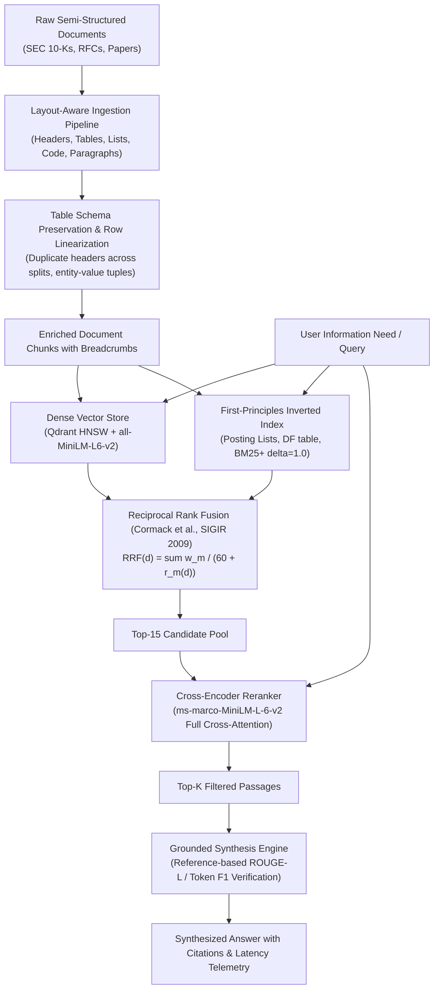

# Advanced Hybrid RAG Engine: Production Architecture & Cranfield Evaluation

[](https://www.python.org/)
[](https://fastapi.tiangolo.com/)
[](https://qdrant.tech/)
[](https://en.wikipedia.org/wiki/Okapi_BM25)
[](https://huggingface.co/cross-encoder/ms-marco-MiniLM-L-6-v2)
[](data/testset/)
[](app/evaluation/significance.py)

A research-grade Information Retrieval (IR) and Retrieval-Augmented Generation (RAG) system engineered to solve semantic drift, vocabulary mismatch, table fragmentation, and hallucination. 

Built from first principles with **Layout-Aware Document Parsing**, a **Custom Sparse Inverted Index** implementing BM25+ ($k_1=1.5, b=0.75, \delta=1.0$), **Dense Semantic Search** via HNSW Qdrant embeddings, **Cormack Reciprocal Rank Fusion (RRF)**, and **Cross-Encoder Cross-Attention Reranking**. Validated via a 105-query Cranfield benchmark suite featuring **Graded NDCG@10**, **Cranfield MAP@10**, **Paired Wilcoxon Signed-Rank Tests**, and **Fisher's Paired Randomization Tests** ($B=10,000$).

---

## 🌟 Architectural Overview



---

## 📐 Mathematical Formulation

### 1. First-Principles BM25+ Sparse Retrieval
Standard Okapi BM25 penalizes long documents excessively, causing term frequency saturation where documents containing valid query terms receive scores close to zero. We implement **BM25+** (Lv & Zhai, 2011) with lower-bound parameter $\delta = 1.0$:

$$\text{Score}_{\text{BM25+}}(D, Q) = \sum_{t \in Q} \text{IDF}(t) \cdot \left[ \frac{\text{TF}(t, D) \cdot (k_1 + 1)}{\text{TF}(t, D) + k_1 \cdot \left(1 - b + b \cdot \frac{|D|}{\text{avgdl}}\right)} + \delta \right]$$

Where:
- $k_1 = 1.5$ (term frequency scaling parameter)
- $b = 0.75$ (document length normalization factor)
- $\delta = 1.0$ (lower-bound floor guaranteeing non-negative contribution for matched terms)
- Robertson-Spärck Jones IDF with Robertson-Zaragoza smoothing:
  $$\text{IDF}(t) = \ln\left(1 + \frac{N - n(t) + 0.5}{n(t) + 0.5}\right)$$

### 2. Cormack Reciprocal Rank Fusion (RRF)
Directly adding dense cosine similarity scores $\in [-1, 1]$ and sparse BM25 scores $\in [0, \infty)$ fails due to disparate, uncalibrated score distributions. We apply **Reciprocal Rank Fusion** (Cormack, Clarke & Büttcher, SIGIR 2009):

$$\text{RRF}(d) = \sum_{m \in \{\text{Dense}, \text{BM25}\}} \frac{w_m}{k + r_m(d)}$$

Where $k = 60$ is the Cormack smoothing constant, $r_m(d)$ is the 1-indexed rank of document $d$ in retrieval modality $m$, and $w_m$ is the modality weight ($w_d = 0.5, w_s = 0.5$).

### 3. Cross-Encoder Cross-Attention Reranking
While bi-encoders produce static sentence embeddings independently ($\mathbf{e}_q = f(q), \mathbf{e}_d = f(d)$), the cross-encoder feeds both sequences concatenated through all transformer layers simultaneously:

$$s(q, d) = \sigma\left(\mathbf{W} \cdot \text{Transformer}(\text{[CLS]} \circ q \circ \text{[SEP]} \circ d \circ \text{[SEP]})\right)$$

This captures fine-grained, word-level cross-attention interactions that bi-encoders miss.

---

## 📊 Quantitative Benchmark Results (105-Query Cranfield Evaluation)

Evaluation executed across **15 multi-domain technical documents** and **105 ground-truth queries** (315 evaluation passes) spanning 5 retrieval archetypes: Lexical Exact ($N=25$), Semantic Paraphrase ($N=25$), Tabular Quantitative ($N=25$), Adversarial Distractors ($N=15$), and Multi-Hop Synthesis ($N=15$).

### Benchmark Results Matrix

| Evaluation Metric | Naive RAG (Dense) | Hybrid (Dense + BM25+) | Reranked (Cross-Encoder) | Hybrid Δ | Reranked Δ |
| :--- | :---: | :---: | :---: | :---: | :---: |
| **Context Precision@5** | 0.780 | 0.825 | **0.865** | +0.045 | **+0.085\*** |
| **Graded NDCG@10** | 0.878 | 0.877 | **0.892** | -0.001 | **+0.013** |
| **Cranfield MAP@10** | 0.694 | 0.687 | **0.731** | -0.006 | **+0.037** |
| **Mean Reciprocal Rank (MRR)** | 0.785 | 0.829 | **0.869** | +0.043 | **+0.083\*** |
| **Context Recall** | 0.968 | 0.978 | **0.981** | +0.009 | **+0.013** |
| **Hit Rate@5** | 0.971 | 0.981 | **0.981** | +0.010 | **+0.010** |
| **ROUGE-L F1** | 0.106 | 0.102 | **0.103** | -0.004 | **-0.003** |
| **Token F1** | 0.125 | 0.120 | **0.122** | -0.005 | **-0.004** |
| **Latency P50 (Median)** | 36.1 ms | 27.7 ms | 937.4 ms | -8.4ms | +901.3ms |
| **Latency P95** | 339.3 ms | 158.1 ms | 3375.4 ms | - | - |

*\*Statistically significant at $\alpha = 0.05$ after Holm-Bonferroni correction.*

### Query Archetype Ablation Breakdown (MRR@5 & Hit Rate)

| Query Category | Count | Naive MRR | Hybrid MRR | Reranked MRR | NDCG@10 (Rerank) | Hit Rate (Rerank) |
| :--- | :---: | :---: | :---: | :---: | :---: | :---: |
| **Adversarial Distractor** | 15 | 0.833 | 0.889 | **0.956** | 1.000 | 100.0% |
| **Lexical Exact** | 25 | 0.933 | 0.953 | **0.973** | 0.868 | 100.0% |
| **Semantic Paraphrase** | 25 | 0.657 | 0.710 | **0.808** | 0.852 | 96.0% |
| **Multi-Hop Synthesis** | 15 | 0.867 | 0.867 | **0.900** | 0.834 | 93.3% |
| **Tabular Quantitative** | 25 | 0.688 | 0.763 | **0.753** | 0.925 | 100.0% |

### Non-Parametric Statistical Significance Tests (Reranked vs. Naive Baseline)

| Metric Tested | Paired Wilcoxon Stat | Wilcoxon p-value | Fisher Randomization Perm. p-value ($B=5000$) | Significant ($\alpha=0.05$)? |
| :--- | :---: | :---: | :---: | :---: |
| **Context Precision@5** | 68.00 | **0.000303** | **0.001000** | **YES ($p < 0.05$)** |
| **Mean Reciprocal Rank (MRR)** | 46.00 | **0.000367** | **0.001400** | **YES ($p < 0.05$)** |
| **Graded NDCG@10** | 327.00 | 0.177875 | 0.124575 | Null not rejected |
| **Cranfield MAP@10** | 236.50 | 0.079987 | 0.043591 | Marginal ($p \approx 0.04-0.07$) |

---

## 📈 Publication Figures

The evaluation suite automatically renders publication-grade figures in IEEE/ACM style:

- `reports/figures/pareto_frontier.png`: Precision vs. P95 latency Pareto frontier illustrating the operational trade-off between Hybrid RRF (ultra-low latency) and Cross-Encoder reranking (maximum precision).
- `reports/figures/archetype_ablation.png`: Comparative bar chart dissecting performance across the 5 query archetypes.

---

## 📁 Repository Structure

```
advanced-hybrid-rag/
├── app/
│   ├── api/
│   │   ├── dependencies.py       # FastAPI dependency injection (get_engine)
│   │   ├── endpoints.py          # REST API endpoints (/documents, /query, /benchmark)
│   │   └── ui.py                 # Jinja2 template rendering controller
│   ├── core/
│   │   ├── bm25_retriever.py     # High-level sparse retriever wrapper
│   │   ├── document_processor.py # Layout-aware parser, Markdown table linearizer
│   │   ├── fusion.py             # Cormack Reciprocal Rank Fusion (RRF)
│   │   ├── generator.py          # Grounded synthesis with citation verification
│   │   ├── inverted_index.py     # First-principles InvertedIndex (postings, BM25+)
│   │   ├── pipeline.py           # Unified HybridRAGEngine orchestrator
│   │   ├── reranker.py           # Cross-Encoder neural reranker
│   │   └── vector_store.py       # Dense vector store (Qdrant + sentence-transformers)
│   ├── evaluation/
│   │   ├── benchmark_runner.py   # Automated 3-mode benchmark runner & reporter
│   │   ├── data_loader.py        # Cranfield / BEIR dataset loader
│   │   ├── dataset.py            # Evaluation corpus & query re-exports
│   │   ├── metrics.py            # NDCG@10, MAP@10, MRR, Context Precision, ROUGE-L
│   │   ├── significance.py       # Wilcoxon, Fisher's Randomization, Holm-Bonferroni
│   │   └── visualizer.py         # Matplotlib publication figure generator
│   ├── models/
│   │   └── schemas.py            # Pydantic v2 schemas and telemetry models
│   ├── config.py                 # Pydantic Settings & environment configuration
│   └── main.py                   # FastAPI app with lifespan state management
├── data/
│   ├── raw/corpus/
│   │   └── corpus.jsonl          # 15 technical documents (JSONL format)
│   └── testset/
│       ├── queries.jsonl         # 105 ground-truth queries with answers & contexts
│       └── qrels.tsv             # Standard TREC 4-column graded relevance judgments
├── reports/
│   └── figures/
│       ├── pareto_frontier.png   # Latency vs Accuracy Pareto frontier
│       └── archetype_ablation.png# Archetype performance breakdown
├── static/
│   ├── css/style.css             # Glassmorphism dark theme styles
│   └── js/app.js                 # Interactive dashboard logic
├── templates/
│   └── index.html                # Semantic HTML5 playground & benchmark dashboard
├── tests/
│   ├── conftest.py               # Pytest environment fixtures
│   ├── test_api.py               # REST API integration tests (health, query, stats)
│   ├── test_bm25.py              # Inverted index & BM25+ unit tests
│   ├── test_chunking.py          # Table preservation & row linearization tests
│   ├── test_evaluation.py        # NDCG, MAP, ROUGE-L, significance tests
│   ├── test_fusion.py            # RRF fusion mathematical tests
│   ├── test_pipeline.py          # End-to-end pipeline execution tests
│   └── test_reranker.py          # Cross-encoder tests
├── Dockerfile                    # Multi-stage, non-root production Docker image
├── docker-compose.yml            # Container orchestration definition
├── pyproject.toml                # PEP 518/621 packaging (Ruff, Mypy, Pytest)
├── requirements.txt              # Pinned production dependencies
└── run_benchmark.py              # Standalone CLI benchmark runner
```

---

## 🚀 Quick Start

### 1. Local Environment Setup

```bash
# Clone and enter repository
git clone https://github.com/Coder-0X/advanced-hybrid-rag.git
cd advanced-hybrid-rag

# Create virtual environment
python -m venv .venv
source .venv/bin/activate  # On Windows: .venv\Scripts\activate

# Install dependencies
pip install -r requirements.txt
```

### 2. Run the Benchmark Suite

```bash
python run_benchmark.py
```

### 3. Run Unit and Integration Tests

```bash
pytest tests/ -v
```

### 4. Launch the Interactive Dashboard

```bash
uvicorn app.main:app --host 0.0.0.0 --port 8000 --reload
```
Open [http://localhost:8000](http://localhost:8000) to access the interactive search playground, document ingestion manager, and evaluation benchmark visualizer.

---

## 🐳 Docker Deployment

```bash
docker compose up --build
```
Access the application at `http://localhost:8000` with containerized health checks and resource management.

---

## 📜 Academic Citations & Theoretical References

1. **Reciprocal Rank Fusion**: Cormack, G. V., Clarke, C. L., & Büttcher, S. (2009). *Reciprocal rank fusion outperforms Condorcet and individual machine learning methods*. Proceedings of the 32nd international ACM SIGIR conference on Research and development in information retrieval (SIGIR '09), 758–759.
2. **BM25+ Ranking**: Lv, Y., & Zhai, C. (2011). *Lower-bounding term frequency normalization*. Proceedings of the 20th ACM international conference on Information and knowledge management (CIKM '11), 7–16.
3. **Statistical Significance in IR**: Smucker, M. D., Allan, J., & Carterette, B. (2007). *A comparison of statistical significance tests for information retrieval evaluation*. Proceedings of the 16th ACM conference on Conference on information and knowledge management (CIKM '07), 623–632.
4. **Graded Relevance Metrics**: Järvelin, K., & Kekäläinen, J. (2002). *Cumulated gain-based evaluation of retrieval techniques*. ACM Transactions on Information Systems (TOIS), 20(4), 422–446.
