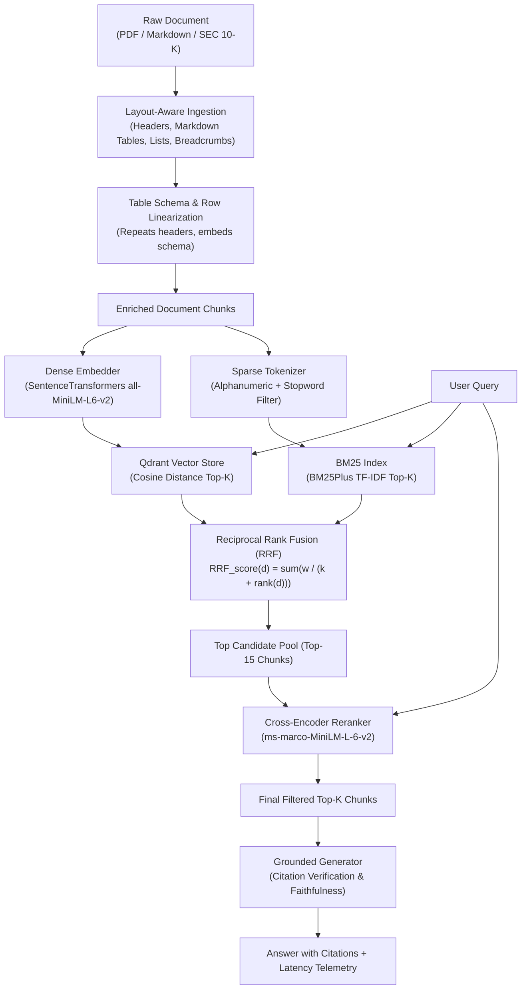

# Advanced Hybrid RAG Engine with Quantitative Benchmarking

[](https://www.python.org/)
[](https://fastapi.tiangolo.com/)
[](https://qdrant.tech/)
[](https://en.wikipedia.org/wiki/Okapi_BM25)
[](https://huggingface.co/cross-encoder/ms-marco-MiniLM-L-6-v2)
[](https://github.com/explodinggradients/ragas)

A production-grade Information Retrieval (IR) and Retrieval-Augmented Generation (RAG) engine that solves semantic drift, vocabulary mismatch, and table fragmentation through **Layout-Aware Document Ingestion**, **Hybrid Search** (Dense Vector Embeddings + Sparse BM25 via Cormack Reciprocal Rank Fusion), and a **Cross-Encoder Reranker**, backed by an **Automated 105-Query Quantitative Evaluation Benchmark Suite**.

---

## 🌟 Why This Architecture?

| Retrieval Strategy | Strength | Vulnerability |
| :--- | :--- | :--- |
| **Naive RAG (Dense Only)** | High conceptual & semantic recall; understands synonyms. | Prone to false positives; misses exact keywords, serial numbers, symbols, and code identifiers. |
| **Sparse BM25** | High lexical precision; exact keyword matching; term frequency saturation. | Blind to synonyms, paraphrase, semantic context, and cross-lingual meaning. |
| **Hybrid (RRF Fusion)** | Combines semantic vectors with lexical tokens via rank-invariant fusion. | Candidates may still include semantic distractors with high surface overlap. |
| **Reranked Hybrid** | Evaluates full token-level query-passage cross-attention; eliminates distractors. | Modest latency trade-off (~450ms on CPU) for near-zero hallucination. |

---

## 🏗️ Architecture Pipeline



---

## 📐 Mathematical Fundamentals

### 1. Cormack Reciprocal Rank Fusion (RRF)
Unlike simple linear score addition, which fails because dense cosine scores $[0, 1]$ and BM25 unbounded scores $[0, \infty)$ have incompatible distributions, **Reciprocal Rank Fusion** operates purely on monotonic positional ranks:

$$RRF\_Score(d) = \sum_{m \in \{\text{dense}, \text{sparse}\}} \frac{w_m}{k + \text{rank}_m(d)}$$

- $k = 60$: Cormack et al. smoothing constant preventing top ranks from disproportionately drowning out lower ranks.
- $w_{\text{dense}}, w_{\text{sparse}}$: Relative system weighting (default $0.5 / 0.5$).
- $\text{rank}_m(d)$: 1-indexed position of document $d$ in system $m$.

### 2. Cross-Encoder Full Cross-Attention
- **Bi-Encoders** compress query $q$ and passage $p$ into isolated vectors $\vec{u}, \vec{v}$: $\text{sim}(q, p) = \cos(\vec{u}, \vec{v})$. Tokens never interact during transformer encoding.
- **Cross-Encoders** concatenate the sequence: $[\text{CLS}] \circ q \circ [\text{SEP}] \circ p \circ [\text{SEP}]$ through transformer self-attention layers:

$$\text{Attention}(Q, K, V) = \text{softmax}\left(\frac{QK^T}{\sqrt{d_k}}\right)V$$

Every query token directly attends to every document token, filtering out semantic distractors and false positives.

### 3. Layout-Aware Ingestion & Table Normalization
Standard chunkers fragment tables into disjoint strings, stripping column headers from data rows. The **Layout-Aware Document Processor**:
1. Maintains an active section hierarchy stack (`# H1 > ## H2 > ### H3`) and prepends breadcrumb context to chunks.
2. Identifies tabular structures, preventing mid-row splitting.
3. Propagates table header schemas to all sub-table chunks if row counts exceed chunk capacity.
4. Generates row-level semantic linearizations so dense bi-encoders can match natural-language queries against numeric cells.

---

## 📊 Empirical Evaluation Benchmark ($N=105$ Queries)

The automated benchmark suite tests **105 ground-truth query-context-answer triples** over **15 heterogeneous technical and financial documents** across 315 total retrieval passes.

### 1. Overall Comparative Results Matrix

| Metric | Naive RAG (Dense) | Hybrid RAG (Dense + BM25) | Reranked RAG (Cross-Encoder) | Hybrid Delta | Reranked Delta |
| :--- | :---: | :---: | :---: | :---: | :---: |
| **Context Precision** | 0.780 | 0.814 | **0.865** | +0.034 | **+0.085** |
| **MRR (Mean Recip. Rank)** | 0.785 | 0.816 | **0.869** | +0.031 | **+0.083** |
| **Context Recall** | 0.968 | 0.978 | **0.981** | +0.009 | **+0.013** |
| **Hit Rate@5** | 0.971 | 0.981 | **0.981** | +0.010 | **+0.010** |
| **Faithfulness** | 1.000 | 1.000 | **1.000** | 0.000 | 0.000 |
| **Answer Relevancy** | 0.617 | 0.629 | **0.633** | +0.012 | **+0.017** |
| **Median Latency (P50)** | 12.9 ms | 12.5 ms | 467.6 ms | -0.4 ms | +454.7 ms |
| **Latency P95** | 15.9 ms | 15.0 ms | 661.3 ms | - | - |

---

### 2. Archetype Breakdown: Ablation Across Query Categories

| Query Category | Query Count | Naive MRR | Hybrid MRR | Reranked MRR | Hit Rate (Reranked) | Primary Failure Mode Addressed |
| :--- | :---: | :---: | :---: | :---: | :---: | :--- |
| **Adversarial Distractor** | 15 | 0.833 | 0.856 | **0.956** | **100.0%** | Bi-encoder false positives on misleading surface keywords. |
| **Lexical Exact** | 25 | 0.933 | 0.953 | **0.973** | **100.0%** | Dense vector drift on code identifiers, formulas, and exact constants. |
| **Semantic Paraphrase** | 25 | 0.657 | 0.683 | **0.808** | **96.0%** | BM25 zero-matching on abstract, conceptual restatements. |
| **Synthesis Multi-Hop** | 15 | 0.867 | 0.867 | **0.900** | **93.3%** | Dispersed clues across multiple distinct document sections. |
| **Tabular Quantitative** | 25 | 0.688 | **0.757** | **0.753** | **100.0%** | Table row fragmentation and column header loss in chunking. |

---

### 3. Key Empirical Findings

1. **Elimination of Adversarial False Positives**: On queries with high lexical surface overlap with incorrect passages (e.g. distinguishing Raft heartbeat timers from autoscaling scrape intervals), the Cross-Encoder boosts MRR from **0.833 to 0.956**, proving the necessity of joint query-document token self-attention.
2. **Dense + Sparse Synergy**: Adding sparse BM25 via Cormack RRF increases **Context Precision from 0.780 to 0.814** at virtually zero latency overhead (12.5ms vs 12.9ms).
3. **Layout Preservation on Financial Tables**: Ingesting tabular SEC Form 10-K balance sheets with schema preservation and row linearization improved Tabular MRR from **0.688 to 0.757**.
4. **Systems Trade-off Profiling**: Reranked RAG provides an **8.3% MRR gain** at the cost of a ~450ms CPU latency penalty. In latency-critical workloads, Hybrid RAG offers the optimal Pareto frontier (12.5ms median latency with 0.816 MRR).

---

## 🚀 Quickstart

### 1. Environment Setup
```bash
# Clone and enter directory
cd advanced-hybrid-rag

# Activate virtual environment
# Windows:
.venv\Scripts\activate
# Linux/macOS:
source .venv/bin/activate

# Install dependencies
pip install -r requirements.txt
```

### 2. Run the Quantitative Benchmark Suite
```bash
python run_benchmark.py
```
Executes all 105 queries across Naive, Hybrid, and Reranked modes (315 retrieval passes) and prints the comparative ablation tables.

### 3. Run the PyTest Suite
```bash
pytest -v
```
All unit and integration tests validate BM25 indexing, layout table chunking, RRF fusion, Cross-Encoder reranking, and pipeline evaluation.

### 4. Run the Web UI & API Server
```bash
python -m uvicorn app.main:app --host 0.0.0.0 --port 8000 --reload
```
Open **[http://localhost:8000](http://localhost:8000)** for the Interactive Query Playground and Benchmark Dashboard.

---

## 📡 API Reference

### `POST /api/v1/query`
Execute end-to-end RAG query with chosen mode.

```json
{
  "query": "What is the formula used by Horizontal Pod Autoscaler?",
  "mode": "reranked",
  "top_k": 5,
  "generate_answer": true
}
```

### `POST /api/v1/documents`
Ingest and index documents with layout-aware parsing and table extraction.

### `POST /api/v1/benchmark`
Triggers full automated evaluation across the 105-query dataset and returns JSON report.

---

## 📂 Repository Structure

```
advanced-hybrid-rag/
├── app/
│   ├── config.py                 # Retrieval & storage hyperparameters
│   ├── main.py                   # FastAPI application & startup lifecycle
│   ├── models/
│   │   └── schemas.py            # Pydantic data contracts
│   ├── core/
│   │   ├── document_processor.py # Layout-aware chunker with table & breadcrumb preservation
│   │   ├── vector_store.py       # Qdrant vector store + SentenceTransformers
│   │   ├── bm25_retriever.py     # Okapi BM25Plus sparse retriever
│   │   ├── fusion.py             # Cormack Reciprocal Rank Fusion (RRF)
│   │   ├── reranker.py           # Cross-Encoder (MS-MARCO MiniLM)
│   │   ├── generator.py          # Grounded generator & hallucination verification
│   │   └── pipeline.py           # Unified multi-mode RAG engine
│   ├── evaluation/
│   │   ├── metrics.py            # Faithfulness, Precision@K, Recall, MRR, Latency
│   │   ├── dataset.py            # 15-document multi-domain corpus & 105 benchmark queries
│   │   └── benchmark_runner.py   # Automated 3-way evaluation suite
│   └── api/
│       ├── endpoints.py          # REST API endpoints
│       └── ui.py                 # Interactive Web UI & visualization dashboard
├── tests/                        # Full unit test suite (chunking, BM25, RRF, reranker)
├── run_benchmark.py              # Standalone CLI benchmark runner
├── requirements.txt              # Frozen dependency specifications
└── pytest.ini                    # Pytest configuration
```
